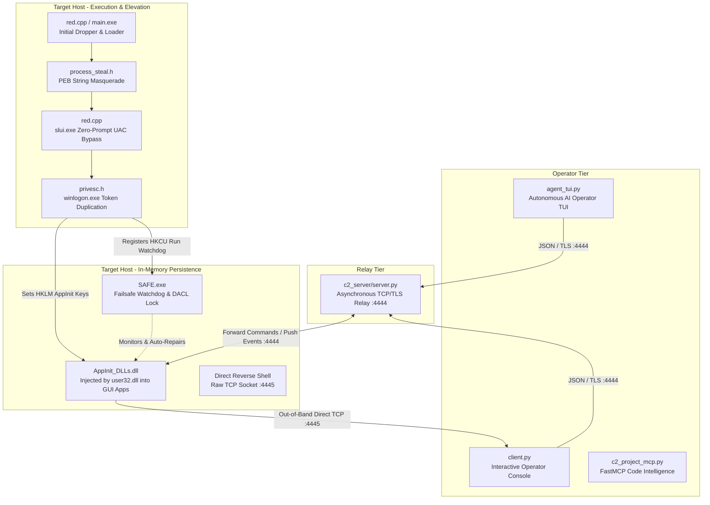
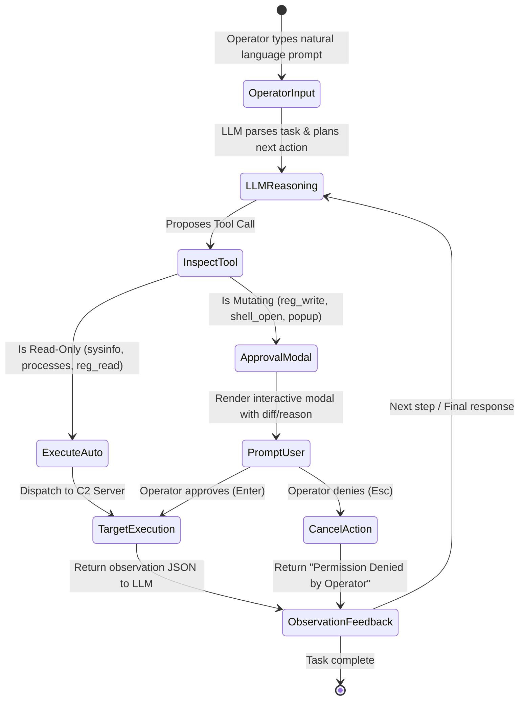

# AgentRed: Comprehensive Technical Specification
**Advanced Adversary Simulation & Command & Control Architectures**

---

## Abstract

Modern endpoint detection and response (EDR) platforms employ a combination of user-mode API hooking, process lineage heuristics, and Authenticode signature verification to identify unauthorized execution. **AgentRed** is an advanced adversary simulation framework designed to explore the boundaries of user-mode evasion, process masquerading, native Windows persistence mechanisms, and autonomous Command & Control (C2) operations.

This document serves as the formal technical specification for the AgentRed framework. It details the complete attack lifecycle, analyzes low-level Windows internals (PE header structures, the Process Environment Block, token privilege models, and AppInit_DLLs), outlines modern C2 transport mechanics, presents an autonomous AI operator interface, and provides defensive engineering guidelines including Sysmon telemetry, YARA rules, and remediation mechanisms.

---

## Table of Contents
1. [Research Objectives & Threat Model](#1-research-objectives--threat-model)
2. [End-to-End System Architecture](#2-end-to-end-system-architecture)
3. [Evasion & Masquerading Subsystems](#3-evasion--masquerading-subsystems)
   - 3.1 [Authenticode Signature Transplanting & PE Analysis](#31-authenticode-signature-transplanting--pe-analysis)
   - 3.2 [In-Memory PEB Masquerading & Dynamic Impersonation](#32-in-memory-peb-masquerading--dynamic-impersonation)
4. [Privilege Escalation & Token Duplication](#4-privilege-escalation--token-duplication)
   - 4.1 [UAC Auto-Elevate Registry Hijacking](#41-uac-auto-elevate-registry-hijacking)
   - 4.2 [Token Stealing from SYSTEM Processes](#42-token-stealing-from-system-processes)
   - 4.3 [Windows Defender Exclusion Tampering](#43-windows-defender-exclusion-tampering)
   - 4.4 [Advanced Research Exploits & Local PrivEsc PoCs (`files/`)](#44-advanced-research-exploits--local-privesc-pocs-files)
5. [Persistence & Self-Healing Watchdog](#5-persistence--self-healing-watchdog)
   - 5.1 [AppInit_DLLs In-Memory Injection](#51-appinit_dlls-in-memory-injection)
   - 5.2 [DACL Anti-Deletion File Locking](#52-dacl-anti-deletion-file-locking)
   - 5.3 [SAFE.exe Self-Healing Watchdog](#53-safeexe-self-healing-watchdog)
   - 5.4 [Windows 10/11 Secure Boot & AppInit_DLLs Constraints](#54-windows-1011-secure-boot--appinit_dlls-constraints)
6. [Command & Control (C2) Engine](#6-command--control-c2-engine)
   - 6.1 [Asynchronous JSON Wire Protocol](#61-asynchronous-json-wire-protocol)
   - 6.2 [Push Event Telemetry & WinEvent Hooks](#62-push-event-telemetry--winevent-hooks)
   - 6.3 [Out-of-Band Direct TCP Reverse Shell](#63-out-of-band-direct-tcp-reverse-shell)
7. [Autonomous AI Operator & Tool Ecosystem](#7-autonomous-ai-operator--tool-ecosystem)
   - 7.1 [Textual TUI & Human-in-the-Loop Safety Gates](#71-textual-tui--human-in-the-loop-safety-gates)
   - 7.2 [Tool Abstraction vs. FastMCP Code Intelligence](#72-tool-abstraction-vs-fastmcp-code-intelligence)
   - 7.3 [Comprehensive Operator & Agent User Guide](#73-comprehensive-operator--agent-user-guide)
8. [MITRE ATT&CK Mapping Matrix](#8-mitre-attck-mapping-matrix)
9. [Blue Team Detection Engineering & Forensics](#9-blue-team-detection-engineering--forensics)
   - 9.1 [Expanded Sysmon Detection Telemetry](#91-expanded-sysmon-detection-telemetry)
   - 9.2 [YARA Detection Rule](#92-yara-detection-rule)
   - 9.3 [Production Sigma Detection Rules](#93-production-sigma-detection-rules)
   - 9.4 [Memory Forensics & Volatility 3 Analysis](#94-memory-forensics--volatility-3-analysis)
   - 9.5 [Consolidated Indicators of Compromise (IOC) Matrix](#95-consolidated-indicators-of-compromise-ioc-matrix)
10. [Remediation & Incident Response](#10-remediation--incident-response)
    - 10.1 [Built-in Remediation via SAFE.exe (`/remove`)](#101-built-in-remediation-via-safeexe-remove)
    - 10.2 [Post-Incident Remediation Checklist](#102-post-incident-remediation-checklist)

---

## 1. Research Objectives & Threat Model

### 1.1 Research Objectives
Security mechanisms are frequently designed with assumptions regarding file integrity, trust chains, process boundaries, and operator speed. AgentRed was developed to test these assumptions in a controlled security research setting:
- **Trust Assumption Testing**: Testing whether digital signature indicators in Portable Executable (PE) headers deceive heuristic scanners even when mathematical certificate validation fails.
- **Process Lineage Assumption Testing**: Testing how forensic and monitoring utilities (Process Explorer, Task Manager, Event Viewer) handle processes whose command line and image paths are dynamically manipulated in runtime memory.
- **Persistence Architecture**: Investigating user32-mediated injection via `AppInit_DLLs` alongside Discretionary Access Control List (DACL) restrictions that prevent standard user or admin file removal.
- **Autonomous Operations**: Investigating the latency, safety boundaries, and operational ergonomics of autonomous LLMs controlling multi-module C2 frameworks under explicit Rules of Engagement (RoE).

### 1.2 Threat Profile
The framework simulates an **Advanced Persistent Threat (APT)** actor possessing post-compromise code execution on an unprivileged Windows endpoint, with the primary goals of escalating to `NT AUTHORITY\SYSTEM`, establishing resilient persistence, streaming user activities, and providing remote operators with interactive control.

---

## 2. End-to-End System Architecture



```
                                  ┌────────────────────────┐
                                  │   Operator / Analyst   │
                                  └───────────┬────────────┘
                                              │
                      ┌───────────────────────┴───────────────────────┐
                      │                                               │
                      ▼                                               ▼
         ┌─────────────────────────┐                     ┌─────────────────────────┐
         │     agent_tui.py        │                     │        client.py        │
         │   (Textual AI TUI)      │                     │    (Interactive CLI)    │
         └────────────┬────────────┘                     └────────────┬────────────┘
                      │                                               │
                      │  JSON Commands over TLS                       │  Direct Shell Listener
                      │  (:4444)                                      │  (:4445)
                      ▼                                               │
         ┌─────────────────────────┐                                  │
         │   c2_server/server.py   │                                  │
         │   (Relay & Broadcaster) │                                  │
         └────────────┬────────────┘                                  │
                      │                                               │
                      │  JSON Commands / Push Events                  │
                      │  (:4444)                                      │
                      ▼                                               │
    ================== VICTIM MACHINE / TARGET SYSTEM =============== │
                      │                                               │
        ┌─────────────┴─────────────┐                                 │
        │ Dropper: red.cpp          │                                 │
        │  1. PEB Masquerading      │                                 │
        │  2. UAC Auto-Elevate      │                                 │
        │  3. Token Steal (SYSTEM)  │                                 │
        └─────────────┬─────────────┘                                 │
                      ▼                                               │
        ┌───────────────────────────┐                                 │
        │ Setup Persistence Keys    │                                 │
        │ HKLM AppInit_DLLs         │                                 │
        │ HKCU Run -> SAFE.exe      │                                 │
        └───────┬───────────┬───────┘                                 │
                │           │                                         │
     Every GUI  │           │ Every Login                             │
     Process    ▼           ▼                                         │
        ┌───────────────┐ ┌───────────────┐                           │
        │AppInit_DLLs.dll│ │   SAFE.exe    │                           │
        │  (dll.cpp)    │ │  (Watchdog)   │                           │
        │ C2 Implant    │ │  Self-Healing │                           │
        └───────┬───────┘ └───────────────┘                           │
                │                                                     │
                └──────────────── Raw TCP Interactive Shell ──────────┘
```

The system operates across three tiers:
1. **Operator Tier**: Consisting of [`client.py`](file:///Users/matanmishali/AntiGravity/AgentRed/c2_server/client.py) (interactive CLI) and [`agent_tui.py`](file:///Users/matanmishali/AntiGravity/AgentRed/agent/agent_tui.py) (LLM-driven interface featuring approval controls for destructive actions).
2. **Relay Tier**: Represented by [`c2_server/server.py`](file:///Users/matanmishali/AntiGravity/AgentRed/c2_server/server.py), which handles TLS encryption, operator token authentication, command routing, and asynchronous push event distribution.
3. **Implant / Victim Tier**: Comprising the initial privilege escalation payload ([`red.cpp`](file:///Users/matanmishali/AntiGravity/AgentRed/red.cpp)), the core payload DLL ([`dll.cpp`](file:///Users/matanmishali/AntiGravity/AgentRed/dll.cpp)), and the failsafe watchdog ([`SAFE.cpp`](file:///Users/matanmishali/AntiGravity/AgentRed/SAFE.cpp)).

---

## 3. Evasion & Masquerading Subsystems

### 3.1 Authenticode Signature Transplanting & PE Analysis

The tools [`file_analyzer.py`](file:///Users/matanmishali/AntiGravity/AgentRed/file_analyzer.py) and [`cert_spoofer.py`](file:///Users/matanmishali/AntiGravity/AgentRed/cert_spoofer.py) demonstrate how PE binary structures handle digital signatures.

#### PE Security Directory Mechanics
A signed Windows executable contains an entry in the Optional Header's Data Directory table:
`OptionalHeader.DataDirectory[IMAGE_DIRECTORY_ENTRY_SECURITY]` (Index 4).

Unlike other sections, the Security Directory does not exist in mapped virtual memory; it resides exclusively on disk at the end of the PE file as a `WIN_CERTIFICATE` structure containing a PKCS #7 signed data blob.

```
┌─────────────────────────────────────────────────────────────┐
│ DOS Header (MZ) -> e_lfanew offset                          │
├─────────────────────────────────────────────────────────────┤
│ PE Signature ("PE\0\0") & COFF File Header                  │
├─────────────────────────────────────────────────────────────┤
│ Optional Header (PE32 / PE32+)                              │
│   ...                                                       │
│   DataDirectory[4]: IMAGE_DIRECTORY_ENTRY_SECURITY          │
│       VirtualAddress: File Offset of WIN_CERTIFICATE        │
│       Size: Length of WIN_CERTIFICATE structure             │
├─────────────────────────────────────────────────────────────┤
│ Section Table (.text, .rdata, .data, .rsrc)                 │
├─────────────────────────────────────────────────────────────┤
│ Section Raw Data                                            │
├─────────────────────────────────────────────────────────────┤
│ [AUTHENTICODE BLOB] (WIN_CERTIFICATE PKCS#7 Data)           │
└─────────────────────────────────────────────────────────────┘
```

#### Certificate Transplant Workflow
[`cert_spoofer.py`](file:///Users/matanmishali/AntiGravity/AgentRed/cert_spoofer.py) implements the signature copy process:
1. **Extraction**: Reads `VirtualAddress` and `Size` from a legitimate signed executable (e.g., `calc.exe`, `explorer.exe`, or third-party signed executables).
2. **Transfer**: Appends the raw byte buffer to the unauthenticated target binary.
3. **Header Patching**: Updates the target's `DataDirectory[4]` entry with the new file offset and size.
4. **Heuristic Impact**: While `WinVerifyTrust()` fails cryptographically (since the file hash does not match the certificate's signed hash), basic scanners and heuristic filters that only verify the presence of a non-empty `IMAGE_DIRECTORY_ENTRY_SECURITY` often downgrade the threat score of the binary.

---

### 3.2 In-Memory PEB Masquerading & Dynamic Impersonation

Static indicators can be obfuscated on disk, but monitoring systems observe process execution dynamically. In [`process_steal.h`](file:///Users/matanmishali/AntiGravity/AgentRed/process_steal.h) and [`red.cpp`](file:///Users/matanmishali/AntiGravity/AgentRed/red.cpp), AgentRed implements in-memory Process Environment Block (PEB) masquerading.

```
Target Process:                               Our Process:
┌───────────────────────────┐                 ┌───────────────────────────┐
│ PEB                       │                 │ PEB                       │
│  └─ ProcessParameters     │                 │  └─ ProcessParameters     │
│      ├─ CommandLine       │─── Copied to ──▶│      ├─ CommandLine       │
│      ├─ ImagePathName     │                 │      ├─ ImagePathName     │
│      └─ WindowTitle       │                 │      └─ WindowTitle       │
└───────────────────────────┘                 └───────────────────────────┘
```

#### Technical Implementation
1. **Discovery of Legitimate Candidates**:
   [`process_steal.h:PickRandomSignedProcess()`](file:///Users/matanmishali/AntiGravity/AgentRed/process_steal.h#L130) enumerates all active processes via `CreateToolhelp32Snapshot`. For each candidate, it extracts the executable path and queries `WinVerifyTrust` with `WINTRUST_ACTION_GENERIC_VERIFY_V2` to confirm legitimate code signing.
2. **Remote Process Parameter Reading**:
   Using `NtQueryInformationProcess` (`ProcessBasicInformation`), the code resolves the address of the target's remote PEB. It then reads the target's `RTL_USER_PROCESS_PARAMETERS` pointer and extracts:
   - `CommandLine` (`UNICODE_STRING`)
   - `ImagePathName` (`UNICODE_STRING`)
   - `WindowTitle` (`UNICODE_STRING`)
3. **Local PEB Overwrite**:
   [`process_steal.h:ApplyToCurrentProcess()`](file:///Users/matanmishali/AntiGravity/AgentRed/process_steal.h#L240) retrieves the current process's PEB via `NtCurrentTeb()->ProcessEnvironmentBlock`. It replaces the active `UNICODE_STRING` buffers with the harvested values from the signed process.
4. **Security Consequence**:
   Process monitoring tools like `Task Manager` and standard `Sysmon Event ID 1` queries inspect the `RTL_USER_PROCESS_PARAMETERS` structure from user mode. When altered, our malicious binary masquerades as a legitimate Windows service (e.g., `svchost.exe` or `spoolsv.exe`).

---

## 4. Privilege Escalation & Token Duplication

### 4.1 UAC Auto-Elevate Registry Hijacking

Standard administrative accounts in Windows run by default with medium integrity under User Account Control (UAC). To elevate to high integrity without triggering a consent dialog, [`red.cpp`](file:///Users/matanmishali/AntiGravity/AgentRed/red.cpp) utilizes an auto-elevation registry hijack.

```
Step 1: Write Registry Hijack Key (User-writable HKCU)
HKCU\Software\Classes\exefile\shell\open\command
  (Default) = "C:\Users\<Victim>\main.exe"

Step 2: Trigger Auto-Elevating Windows Binary
ShellExecuteW(NULL, "runas", "C:\Windows\System32\slui.exe", ...)

Step 3: Execution Flow
slui.exe executes with auto-elevated High Integrity -> 
Resolves 'exefile' class association ->
Consults HKCU before HKLM ->
Executes our binary with High Integrity!
```

- **Mechanism**: Binaries such as `slui.exe`, `fodhelper.exe`, or `computerdefaults.exe` contain an embedded manifest specifying `<autoElevate>true</autoElevate>`.
- When launched with the `"runas"` verb by a member of the local Administrators group, Windows elevates the process without presenting a UAC prompt.
- As `slui.exe` starts, it queries file association classes in the registry. Because `HKEY_CURRENT_USER\Software\Classes` takes precedence over `HKEY_LOCAL_MACHINE\Software\Classes`, the application executes the binary configured in `exefile\shell\open\command` at High Integrity.

---

### 4.2 Token Stealing from SYSTEM Processes

High Integrity is often insufficient to modify protected system registry hives or inject globally without restrictions. To reach `NT AUTHORITY\SYSTEM`, [`privesc.h`](file:///Users/matanmishali/AntiGravity/AgentRed/privesc.h) implements primary token duplication.

```
┌─────────────────┐       OpenProcess(PROCESS_QUERY_LIMITED_INFORMATION)      ┌──────────────────┐
│  Elevated High  │──────────────────────────────────────────────────────────▶│  winlogon.exe    │
│  Integrity Proc │                                                           │  (SYSTEM Token)  │
└────────┬────────┘                                                           └────────┬─────────┘
         │                                                                             │
         │ 1. LookupPrivilegeValue(SE_DEBUG_NAME)                                      │ OpenProcessToken
         │ 2. AdjustTokenPrivileges()                                                  ▼
         │                                                                    ┌──────────────────┐
         │                                                                    │ cToken (SYSTEM)  │
         │                                                                    └────────┬─────────┘
         │                                                                             │
         │ DuplicateTokenEx(cToken, SecurityImpersonation, TokenPrimary)               │
         │                                                                             ▼
         │                                                                    ┌──────────────────┐
         │                                                                    │ dToken (Primary) │
         │                                                                    └────────┬─────────┘
         ▼                                                                             │
  CreateProcessWithTokenW(dToken, LOGON_WITH_PROFILE, "cmd.exe ...") ◀─────────────────┘
         │
         ▼
  New Process running as NT AUTHORITY\SYSTEM
```

#### Step-by-Step Logic
1. **Enable Debug Privileges**: Calls [`privesc.h:SetPrivilege()`](file:///Users/matanmishali/AntiGravity/AgentRed/privesc.h#L70) to adjust the current token's privileges to include `SE_DEBUG_NAME` (`SeDebugPrivilege`).
2. **Acquire Target Process Handle**: Resolves the PID of `winlogon.exe` (or `lsass.exe`) and calls `OpenProcess` with `PROCESS_QUERY_LIMITED_INFORMATION`.
3. **Extract & Duplicate Token**: Calls `OpenProcessToken` with `MAXIMUM_ALLOWED` access, followed by `DuplicateTokenEx` specifying `SecurityImpersonation` and `TokenPrimary`.
4. **Spawn Elevated Execution**: Executes `CreateProcessWithTokenW` with the cloned primary token, launching child commands with the permissions of `NT AUTHORITY\SYSTEM`.

---

### 4.3 Windows Defender Exclusion Tampering

To prevent real-time behavioral protection or signature-based scanning from quarantining the payload, [`red.cpp`](file:///Users/matanmishali/AntiGravity/AgentRed/red.cpp#L67-L76) modifies Defender preferences:
```cpp
if (IsDefenderRunning()) {
    wstring filename = GetCurrentFile();
    wstring command = L"Add-MpPreference -ExclusionPath '" + filename + L"'";
    ShellExecuteW(NULL, L"runas", L"powershell.exe", command.c_str(), NULL, SW_HIDE);
}
```
This adds the binary's path to Microsoft Defender's exclusion list, preventing on-access scanning of the dropped modules.

---

### 4.4 Advanced Research Exploits & Local PrivEsc PoCs (`files/`)

The repository includes standalone exploit PoCs in the [`files/`](file:///Users/matanmishali/AntiGravity/AgentRed/files) directory exploring low-level kernel and service vulnerabilities:

#### 1. CVE-2026-20817: Windows Error Reporting (WER) ALPC EoP ([`files/CVE-2026-20817_PoC.cpp`](file:///Users/matanmishali/AntiGravity/AgentRed/files/CVE-2026-20817_PoC.cpp))
- **Vulnerability Architecture**: A Local Privilege Escalation flaw within the Windows Error Reporting service. The ALPC port `\WindowsErrorReportingService` exposes the `SvcElevatedLaunch` method (`0x0D`).
- **Exploitation Mechanics**:
  1. Creates an ALPC shared section containing an arbitrary command line.
  2. Connects to `\WindowsErrorReportingService` using `NtAlpcConnectPort`.
  3. Sends an ALPC message invoking method `0x0D`, instructing the service to spawn `WerFault.exe` which executes the command as `NT AUTHORITY\SYSTEM`.
- **Privilege Outcome**: The resulting process token inherits `SeDebugPrivilege` and `SeImpersonatePrivilege`, providing an alternate escalation path if UAC registry hijacks are monitored.

#### 2. CVE-2026-50656: RoguePlanet Defender TOCTOU Race ([`files/CVE-2026-50656.cpp`](file:///Users/matanmishali/AntiGravity/AgentRed/files/CVE-2026-50656.cpp))
- **Mechanism**: Explores a Time-of-Check to Time-of-Use (TOCTOU) race condition during file quarantine operations by `MsMpEng.exe`.
- **Analysis**: Creates directory junctions in `%TEMP%\RogueCheck_` pointing to system directories and simulates rapid file modification to verify if antivirus link resolution can be manipulated into writing arbitrary files with SYSTEM permissions.

#### 3. Token-Based Antivirus Bypass ([`files/token_windefender_bypass.cpp`](file:///Users/matanmishali/AntiGravity/AgentRed/files/token_windefender_bypass.cpp))
- **Mechanism**: Exercises token privilege filtering and token duplication directly to suppress Defender runtime interception without requiring administrative GUI interaction.

---

## 5. Persistence & Self-Healing Watchdog

### 5.1 AppInit_DLLs In-Memory Injection

The primary persistence mechanism for the core agent ([`dll.cpp`](file:///Users/matanmishali/AntiGravity/AgentRed/dll.cpp)) is the Windows `AppInit_DLLs` infrastructure.

```
Registry Configuration:
Hive: HKLM\SOFTWARE\Microsoft\Windows NT\CurrentVersion\Windows
Value: AppInit_DLLs = "C:\Users\<Victim>\AppInit_DLLs.dll"
Value: LoadAppInit_DLLs = 1 (DWORD)
Value: RequireSignedAppInit_DLLs = 0 (DWORD)
```

- **Mechanism**: The dynamic link library `user32.dll` is loaded by nearly every process that creates a graphical user interface or interacts with the Windows messaging subsystem.
- During initialization (`user32!InitUserApiHook`), `user32.dll` checks the `AppInit_DLLs` registry key. If `LoadAppInit_DLLs` is set to 1, it calls `LoadLibrary()` on each DLL listed in the key.
- **Execution**: On `DLL_PROCESS_ATTACH`, [`dll.cpp`](file:///Users/matanmishali/AntiGravity/AgentRed/dll.cpp) initializes its network sockets, connects to the C2 server, and begins executing commands in the background without requiring standard process injection hooks.

---

### 5.2 DACL Anti-Deletion File Locking

To defend against administrative removal, [`SAFE.cpp`](file:///Users/matanmishali/AntiGravity/AgentRed/SAFE.cpp#L120-L160) applies an explicit Discretionary Access Control List (DACL) to both `AppInit_DLLs.dll` and `SAFE.exe`:

```cpp
EXPLICIT_ACCESSA ea[2];
ZeroMemory(&ea, sizeof(ea));

// Deny delete and write DACL to Everyone
ea[0].grfAccessPermissions = DELETE | WRITE_DAC | WRITE_OWNER;
ea[0].grfAccessMode        = DENY_ACCESS;
ea[0].grfInheritance       = NO_INHERITANCE;
ea[0].Trustee.TrusteeForm  = TRUSTEE_IS_NAME;
ea[0].Trustee.ptstrName    = (LPSTR)"Everyone";
```

- By placing an explicit `DENY` access control entry (ACE) for `DELETE`, `WRITE_DAC`, and `WRITE_OWNER` for the `Everyone` group, Windows will reject deletion attempts by standard tools, the file explorer, and administrative command prompts.

---

### 5.3 SAFE.exe Self-Healing Watchdog

[`SAFE.cpp`](file:///Users/matanmishali/AntiGravity/AgentRed/SAFE.cpp) runs as an independent, lightweight watchdog process registered in `HKCU\Software\Microsoft\Windows\CurrentVersion\Run` ("Windows Security Health").

```
                     ┌──────────────────────────────┐
                     │   SAFE.exe Watchdog Loop     │
                     └──────────────┬───────────────┘
                                    │ Sleep(10000)
                                    ▼
                     ┌──────────────────────────────┐
                     │ Check AppInit_DLLs in HKLM   │
                     └──────────────┬───────────────┘
                       /                          \
             Keys Missing / Altered             Keys Intact
                     /                              \
                    ▼                                ▼
       ┌────────────────────────┐      ┌────────────────────────┐
       │ Restore AppInit_DLLs   │      │ Verify DACL on DLL     │
       │ and LoadAppInit_DLLs=1 │      │ and SAFE.exe           │
       └────────────────────────┘      └────────────────────────┘
```

- **Loop Logic**: Every 10 seconds, `SAFE.exe` verifies that the `AppInit_DLLs` registry keys match the payload path.
- **Auto-Recovery**: If a security analyst clears the `AppInit_DLLs` registry value, `SAFE.exe` rewires the registry key and resets the ACL permissions on disk.
- **Safe Removal Mode**: Built into `SAFE.exe` via the `/remove` switch (`SAFE.exe /remove`), which resets DACL permissions and deregisters registry entries for authorized post-lab teardown.

---

### 5.4 Windows 10/11 Secure Boot & AppInit_DLLs Constraints

A critical technical consideration in modern Windows internals is the behavior of `AppInit_DLLs` in environments protected by **UEFI Secure Boot**:

1. **Secure Boot Automatic Suppression**:
   - In standard Windows 10 and 11 configurations where UEFI Secure Boot is active, the operating system kernel and `user32.dll` automatically disable the `AppInit_DLLs` infrastructure globally, ignoring `LoadAppInit_DLLs = 1`.
2. **Code Signing Requirement (`RequireSignedAppInit_DLLs`)**:
   - When Secure Boot is disabled or configured in custom policy mode, Windows evaluates the registry value:
     ```
     HKLM\SOFTWARE\Microsoft\Windows NT\CurrentVersion\Windows\RequireSignedAppInit_DLLs
     ```
   - If set to `1` (default on enterprise builds), `user32.dll` invokes `WinVerifyTrust()` on any candidate DLL and refuses injection if the binary lacks a valid, cryptographically trusted Authenticode certificate.
3. **Lab Emulation Configuration**:
   - In our adversary emulation architecture, the privilege escalation dropper (`red.cpp`) writes:
     ```
     LoadAppInit_DLLs = 1 (DWORD)
     RequireSignedAppInit_DLLs = 0 (DWORD)
     ```
   - For authorized lab evaluations, test VMs must have Secure Boot disabled in firmware settings (or hypervisor settings) to observe `AppInit_DLLs` execution. This underscores why modern blue team defense centers on enforcing Secure Boot and monitoring `RequireSignedAppInit_DLLs` registry changes.

---

## 6. Command & Control (C2) Engine

### 6.1 Asynchronous JSON Wire Protocol

The core communication between operators, the relay server ([`server.py`](file:///Users/matanmishali/AntiGravity/AgentRed/c2_server/server.py)), and the victim implant ([`dll.cpp`](file:///Users/matanmishali/AntiGravity/AgentRed/dll.cpp)) is standardized over a newline-delimited JSON stream over TCP/TLS (default port `4444`).

```
Client / Agent                                          C2 Server
      │                                                     │
      │── {"token": "<secret>", "role": "operator"} ───────▶│ (Handshake)
      │◀─ {"status": "ok", "message": "Authenticated..."} ──│
      │                                                     │
      │── {"module": "activity", "payload": {...}} ────────▶│ (Dispatch)
      │                                                     │── Relayed to Agent
      │                                                     │◀─ Agent Response
      │◀─ {"status": "ok", "processes": [...]} ─────────────│
```

- **Role Differentiation**:
  - `role: "operator"`: Registers the socket to submit commands and receive victim event push notifications.
  - `role: "agent"`: Registers the endpoint as an active victim implant capable of receiving forwarded commands.
- **Relay Synchronization**:
  [`server.py:relay_to_agent()`](file:///Users/matanmishali/AntiGravity/AgentRed/c2_server/server.py#L61) leverages thread-safe queues (`queue.Queue`) to bind an asynchronous request from an operator to the response returned by the connected agent.

---

### 6.2 Push Event Telemetry & WinEvent Hooks

Unlike traditional beaconing C2 implants that poll on static sleep intervals, AgentRed supports an event-driven push channel.
In [`dll.cpp`](file:///Users/matanmishali/AntiGravity/AgentRed/dll.cpp), the agent registers a Windows Event Hook using `SetWinEventHook`:
- **Event Captured**: `EVENT_SYSTEM_FOREGROUND` (`0x0003`)
- **Action**: When the user switches active applications or opens a new browser window, the hook captures the window handle (`HWND`), queries the process name and window title, and streams a notification JSON object to the server:
  ```json
  {
    "event": "window_focus",
    "timestamp": 1773176500,
    "process": "chrome.exe",
    "title": "Internal Portal - Login — Google Chrome"
  }
  ```
- **Broadcasting**: The server broadcasts this event immediately to all connected operators without requiring manual polling.

---

### 6.3 Out-of-Band Direct TCP Reverse Shell

For interactive shell access, relying on JSON command encapsulation introduces parsing overhead and escapes characters inefficiently. AgentRed implements a dedicated out-of-band reverse shell:

```
┌─────────────────────────────────┐                 ┌─────────────────────────────────┐
│     Operator (client.py)        │                 │     Victim (dll.cpp)            │
│  Listens on Raw TCP :4445       │                 │  Direct TCP Socket Connect      │
└────────────────┬────────────────┘                 └────────────────┬────────────────┘
                 │                                                   │
                 │◀────────────── Raw Duplex TCP Stream ─────────────│
                 │   Standard In / Standard Out / Standard Error     │
                 │   Bound directly to child cmd.exe process         │
```

1. The operator launches a local TCP listener on port `4445` using `client.py`'s `shell_open` command.
2. The operator sends a `shell` module command through the C2 JSON channel, instructing the DLL to connect back to `<operator_ip>:4445`.
3. In [`dll.cpp`](file:///Users/matanmishali/AntiGravity/AgentRed/dll.cpp), the implant connects out, allocates an anonymous pipe or directly assigns the socket handle to `STARTUPINFO.hStdInput`, `hStdOutput`, and `hStdError`, and calls `CreateProcessA("cmd.exe")`.
4. The operator interacts with an unbuffered native shell, leaving the main C2 connection free for concurrent operations.

---

## 7. Autonomous AI Operator & Tool Ecosystem

### 7.1 Textual TUI & Human-in-the-Loop Safety Gates

[`agent/agent_tui.py`](file:///Users/matanmishali/AntiGravity/AgentRed/agent/agent_tui.py) introduces an autonomous operator interface driven by LLMs (Claude 3.5 Sonnet, DeepSeek, or local Ollama instances) styled after modern developer terminal interfaces.



- **Tool Abstraction ([`agent_tools.py`](file:///Users/matanmishali/AntiGravity/AgentRed/agent/agent_tools.py))**:
  Wraps the raw C2 commands into 38 distinct tools across system information, activity, registry manipulation, SSH, RDP, file transfer, and notifications.
- **Approval Gate**:
  Read-only operations (e.g., `sysinfo`, `processes`, `reg_read`) execute autonomously. High-risk mutating operations (e.g., `reg_write`, `reg_delete_key`, `shell_open`) halt execution, rendering an interactive modal requiring human operator authorization.

### 7.2 Tool Abstraction vs. FastMCP Code Intelligence

The architecture explicitly separates live operational execution from developer code intelligence:

1. **Operational Agent Tool Layer ([`agent/agent_tools.py`](file:///Users/matanmishali/AntiGravity/AgentRed/agent/agent_tools.py))**:
   - The functional bridge used by the autonomous agent (`agent.py` and `agent_tui.py`).
   - Reuses `C2Client` from `client.py` to authenticate to the running C2 server and dispatch commands to live implants.
   - Includes safety gates, confirmation handling, reverse shell channel management, and file delivery over cmd base64 chunking.
2. **Code Intelligence FastMCP Server ([`c2_server/mcp/c2_project_mcp.py`](file:///Users/matanmishali/AntiGravity/AgentRed/c2_server/mcp/c2_project_mcp.py))**:
   - Standardized FastMCP server designed for IDE assistants (Anthropic Claude Desktop, Cursor, Hermes).
   - Operates strictly in a **read-only code analysis** capacity: parses C++ and Python ASTs, indexes module definitions, extracts wire dispatch wiring, checks regexes, and maps ATT&CK indicators.
   - **Does NOT** open TCP connections to live C2 servers or dispatch offensive commands to victim machines.

### 7.3 Comprehensive Operator & Agent User Guide

For step-by-step operational instructions covering both interfaces, refer to the dedicated **[Operator & Agent User Guide (`docs/USER_GUIDE.md`)](file:///Users/matanmishali/AntiGravity/AgentRed/docs/USER_GUIDE.md)**:
- **CLI Commands (`client.py`)**: Complete command syntax for `act`, `reg`, `ssh`, `rdp`, `notify`, and interactive reverse shell detaching/resuming (`Ctrl+]`).
- **Autonomous Agent Workflows (`agent_tui.py`)**: Instructions for configuring OpenRouter cloud models, local Ollama models (`llama3.1:8b`), offline dry-run demos, slash commands (`/help`, `/tools`, `/events`), and human approval dialogs.

---

## 8. MITRE ATT&CK Mapping Matrix

| ATT&CK Tactic | Technique ID | Technique Name | Implementation Reference |
| :--- | :--- | :--- | :--- |
| **Execution** | T1204.002 | Malicious File Execution | Dropper execution via [`red.cpp`](file:///Users/matanmishali/AntiGravity/AgentRed/red.cpp) |
| **Execution** | T1059.003 | Windows Command Shell | Out-of-band reverse shell in [`dll.cpp`](file:///Users/matanmishali/AntiGravity/AgentRed/dll.cpp) |
| **Persistence** | T1546.010 | Event Triggered: AppInit DLLs | Registry persistence in [`red.cpp`](file:///Users/matanmishali/AntiGravity/AgentRed/red.cpp) & [`dll.cpp`](file:///Users/matanmishali/AntiGravity/AgentRed/dll.cpp) |
| **Persistence** | T1547.001 | Registry Run Keys / Startup Folder | Secondary watchdog persistence in [`SAFE.cpp`](file:///Users/matanmishali/AntiGravity/AgentRed/SAFE.cpp) |
| **Privilege Escalation** | T1548.002 | Bypass User Account Control | Registry hijack via `slui.exe` in [`red.cpp`](file:///Users/matanmishali/AntiGravity/AgentRed/red.cpp) |
| **Privilege Escalation** | T1134.001 | Token Impersonation / Duplication | `winlogon.exe` token duplication in [`privesc.h`](file:///Users/matanmishali/AntiGravity/AgentRed/privesc.h) |
| **Defense Evasion** | T1036.004 | Masquerade Task or Service | Dynamic PEB string overwrite in [`process_steal.h`](file:///Users/matanmishali/AntiGravity/AgentRed/process_steal.h) |
| **Defense Evasion** | T1553.002 | Subvert Trust Controls: Code Signing | Authenticode certificate transplant in [`cert_spoofer.py`](file:///Users/matanmishali/AntiGravity/AgentRed/cert_spoofer.py) |
| **Defense Evasion** | T1562.001 | Impair Defenses: Disable AV / Exclusion | `Add-MpPreference -ExclusionPath` in [`red.cpp`](file:///Users/matanmishali/AntiGravity/AgentRed/red.cpp) |
| **Defense Evasion** | T1222.001 | File Permissions Modification | Restrictive DACL denial entries in [`SAFE.cpp`](file:///Users/matanmishali/AntiGravity/AgentRed/SAFE.cpp) |
| **Discovery** | T1057 | Process Discovery | Toolhelp32 process snapshot in [`dll.cpp`](file:///Users/matanmishali/AntiGravity/AgentRed/dll.cpp) |
| **Collection** | T1056.001 | Keylogging / Window Monitoring | `SetWinEventHook` foreground capture in [`dll.cpp`](file:///Users/matanmishali/AntiGravity/AgentRed/dll.cpp) |
| **Command & Control** | T1071.001 | Application Layer Protocol | JSON over TCP/TLS stream in [`server.py`](file:///Users/matanmishali/AntiGravity/AgentRed/c2_server/server.py) |
| **Command & Control** | T1571 | Non-Standard Port | Direct reverse shell on port 4445 in [`dll.cpp`](file:///Users/matanmishali/AntiGravity/AgentRed/dll.cpp) |

---

## 9. Blue Team Detection Engineering & Forensics

### 9.1 Expanded Sysmon Detection Telemetry

Defenders can detect AgentRed activities across the entire attack chain through targeted Sysmon and Windows Event Log rules:

#### 1. AppInit_DLLs Registry Modifications (Sysmon Event ID 12 & 13)
```xml
<RuleGroup name="Detect_AppInit_Persistence" groupRelation="or">
  <RegistryEvent onmatch="include">
    <TargetObject condition="contains">Microsoft\Windows NT\CurrentVersion\Windows\AppInit_DLLs</TargetObject>
    <TargetObject condition="contains">Microsoft\Windows NT\CurrentVersion\Windows\LoadAppInit_DLLs</TargetObject>
    <TargetObject condition="contains">Microsoft\Windows NT\CurrentVersion\Windows\RequireSignedAppInit_DLLs</TargetObject>
  </RegistryEvent>
</RuleGroup>
```

#### 2. UAC Bypass via File Association Classes (Sysmon Event ID 12 & 13)
```xml
<RuleGroup name="Detect_UAC_Hijack" groupRelation="or">
  <RegistryEvent onmatch="include">
    <TargetObject condition="contains">Software\Classes\exefile\shell\open\command</TargetObject>
  </RegistryEvent>
</RuleGroup>
```

#### 3. Abnormal Process Lineage for Elevated Auto-Elevate Executables (Sysmon Event ID 1)
Monitor for child processes of `slui.exe`. Legitimate executions rarely spawn unverified binaries or script interpreters:
```xml
<RuleGroup name="Detect_Slui_Child_Processes" groupRelation="or">
  <ProcessCreate onmatch="include">
    <ParentImage condition="end with">\slui.exe</ParentImage>
  </ProcessCreate>
</RuleGroup>
```

#### 4. DLL In-Memory Injection across GUI Processes (Sysmon Event ID 7)
`AppInit_DLLs.dll` is loaded into every desktop process linking `user32.dll`:
```xml
<RuleGroup name="Detect_AppInit_ImageLoad" groupRelation="or">
  <ImageLoad onmatch="include">
    <ImageLoaded condition="end with">\AppInit_DLLs.dll</ImageLoaded>
  </ImageLoad>
</RuleGroup>
```

#### 5. Token Stealing Handle Access on Winlogon (Sysmon Event ID 10)
Non-system processes requesting `PROCESS_DUP_HANDLE` (`0x0040`) or `PROCESS_QUERY_INFORMATION` (`0x1400`) against `winlogon.exe`:
```xml
<RuleGroup name="Detect_Winlogon_Handle_Duplication" groupRelation="or">
  <ProcessAccess onmatch="include">
    <TargetImage condition="end with">\winlogon.exe</TargetImage>
    <GrantedAccess condition="contains">0x0040</GrantedAccess>
  </ProcessAccess>
</RuleGroup>
```

#### 6. Outbound C2 Socket Telemetry (Sysmon Event ID 3)
```xml
<RuleGroup name="Detect_C2_Outbound_Ports" groupRelation="or">
  <NetworkConnect onmatch="include">
    <DestinationPort condition="is">4444</DestinationPort>
    <DestinationPort condition="is">4445</DestinationPort>
  </NetworkConnect>
</RuleGroup>
```

#### 7. Windows Defender Tampering (PowerShell ScriptBlock Event ID 4104)
Monitor Microsoft-Windows-PowerShell/Operational Event ID 4104 for strings invoking exclusion additions:
```powershell
ScriptBlockText -match "Add-MpPreference.*-ExclusionPath"
```

---

### 9.2 YARA Detection Rule

```yara
rule AgentRed_Watchdog_Implant {
    meta:
        description = "Detects AgentRed persistence implant and watchdog artifacts"
        author = "Security Research Team"
        date = "2026-10-10"
        score = 85
    strings:
        $str_appinit = "AppInit_DLLs.dll" ascii wide
        $str_mutex   = "Global\\__C2SafeMtx__" ascii wide
        $str_runkey  = "Windows Security Health" ascii wide
        $fn_peb      = "NtQueryInformationProcess" ascii
    condition:
        uint16(0) == 0x5A4D and
        (2 of ($str_appinit, $str_mutex, $str_runkey) or $fn_peb)
}
```

---

### 9.3 Production Sigma Detection Rules

Production-grade Sigma detection rules are provided in the [`docs/sigma/`](file:///Users/matanmishali/AntiGravity/AgentRed/docs/sigma) directory for deployment into SIEMs (Splunk, Elastic, Sentinel):

- 📜 **[`docs/sigma/proc_creation_win_uac_slui_bypass.yml`](file:///Users/matanmishali/AntiGravity/AgentRed/docs/sigma/proc_creation_win_uac_slui_bypass.yml)**: Detects UAC auto-elevation abuse where `slui.exe` spawns unexpected child processes.
- 📜 **[`docs/sigma/registry_set_appinit_dlls_persistence.yml`](file:///Users/matanmishali/AntiGravity/AgentRed/docs/sigma/registry_set_appinit_dlls_persistence.yml)**: Detects persistence configuration in `Microsoft\Windows NT\CurrentVersion\Windows\AppInit_DLLs`.
- 📜 **[`docs/sigma/winlogon_token_stealing_access.yml`](file:///Users/matanmishali/AntiGravity/AgentRed/docs/sigma/winlogon_token_stealing_access.yml)**: Detects unprivileged or anomalous processes opening `winlogon.exe` with duplicate-handle permissions.

---

### 9.4 Memory Forensics & Volatility 3 Analysis

While in-memory PEB masquerading ([`process_steal.h`](file:///Users/matanmishali/AntiGravity/AgentRed/process_steal.h)) successfully deceives user-mode utilities that rely on `NtQueryInformationProcess(ProcessBasicInformation)`, memory forensics can reliably identify the deception:

1. **Kernel EPROCESS vs. User-Mode PEB Discrepancy**:
   - The Windows kernel maintains true executable image tracking in `EPROCESS->SeAuditProcessImageFileName` and the Virtual Address Descriptor (VAD) root.
   - User-mode overwrites only modify `PEB->ProcessParameters->CommandLine` and `ImagePathName`.
2. **Volatility 3 Investigation Workflow**:
   ```bash
   # 1. Scan memory image for all active processes
   python3 vol.py -f memory.dmp windows.psscan

   # 2. Inspect Virtual Address Descriptors for unmapped or injected sections
   python3 vol.py -f memory.dmp windows.malfind --pid <PID>

   # 3. Cross-reference process command lines against mapped image files
   python3 vol.py -f memory.dmp windows.cmdline
   ```
   - **Telltale Anomaly**: `windows.cmdline` will display the masqueraded string (e.g., `svchost.exe -k netsvcs`), while `windows.vadinfo` or `windows.filescan` reveals the actual underlying executable mapped from the user profile directory.

---

### 9.5 Consolidated Indicators of Compromise (IOC) Matrix

| Category | Indicator / Value | Description |
| :--- | :--- | :--- |
| **File Path** | `%USERPROFILE%\AppInit_DLLs.dll` | Core C2 in-memory payload DLL |
| **File Path** | `%USERPROFILE%\SAFE.exe` | Failsafe persistence watchdog binary |
| **File Path** | `%TEMP%\RogueCheck_*` | Temporary artifacts from RoguePlanet TOCTOU testing |
| **Registry Key** | `HKLM\SOFTWARE\Microsoft\Windows NT\CurrentVersion\Windows\AppInit_DLLs` | AppInit injection list |
| **Registry Key** | `HKLM\SOFTWARE\Microsoft\Windows NT\CurrentVersion\Windows\LoadAppInit_DLLs` | Set to `1` (DWORD) |
| **Registry Key** | `HKLM\SOFTWARE\Microsoft\Windows NT\CurrentVersion\Windows\RequireSignedAppInit_DLLs` | Set to `0` (DWORD) |
| **Registry Key** | `HKCU\Software\Microsoft\Windows\CurrentVersion\Run\Windows Security Health` | Watchdog auto-start entry |
| **Registry Key** | `HKCU\Software\Classes\exefile\shell\open\command` | UAC auto-elevate hijack key |
| **Named Mutex** | `Global\__C2SafeMtx__` | Global mutex held by `SAFE.exe` watchdog |
| **Network Port** | TCP `4444` (outbound from victim) | Primary C2 JSON command and event stream |
| **Network Port** | TCP `4445` (outbound from victim) | Out-of-band direct reverse shell connection |
| **Process Lineage**| `slui.exe` spawning non-standard binaries | UAC elevation signature |
| **Process Lineage**| `powershell.exe` with `Add-MpPreference -ExclusionPath` | Antivirus exclusion tampering |

---

## 10. Remediation & Incident Response

### 10.1 Built-in Remediation via SAFE.exe (`/remove`)

To return the lab environment to a baseline state, [`SAFE.cpp`](file:///Users/matanmishali/AntiGravity/AgentRed/SAFE.cpp) includes an explicit `/remove` uninstall helper mode:
1. **DACL Unlocking**: Removes restrictive `DENY` ACEs from `AppInit_DLLs.dll` and `SAFE.exe`.
2. **Neutralizes Registry Values**:
   - Resets `HKLM\SOFTWARE\Microsoft\Windows NT\CurrentVersion\Windows\AppInit_DLLs` to an empty string.
   - Sets `HKLM\SOFTWARE\Microsoft\Windows NT\CurrentVersion\Windows\LoadAppInit_DLLs` to `0`.
3. **Removes Run Persistence**:
   - Deletes `HKCU\Software\Microsoft\Windows\CurrentVersion\Run\Windows Security Health`.
4. **Removes File Associations**:
   - Purges `HKCU\Software\Classes\exefile\shell\open\command`.

### 10.2 Post-Incident Remediation Checklist
- Verify registry value `LoadAppInit_DLLs` is `0`.
- Verify no anomalous DLLs appear in process inspection tools (e.g., Process Explorer -> View DLLs -> search for `AppInit_DLLs.dll`).
- Verify Microsoft Defender preferences have no persistent exclusion paths via `Get-MpPreference | Select-Object ExclusionPath`.
